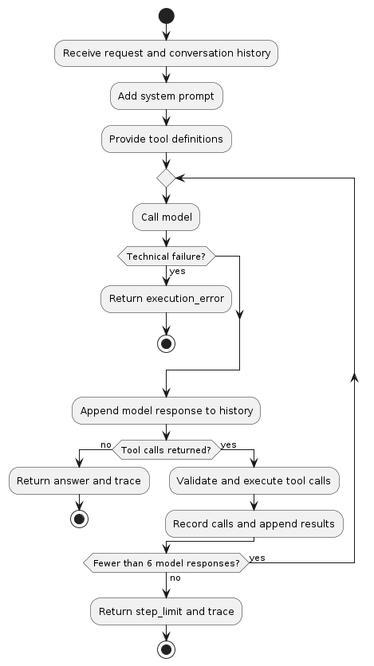
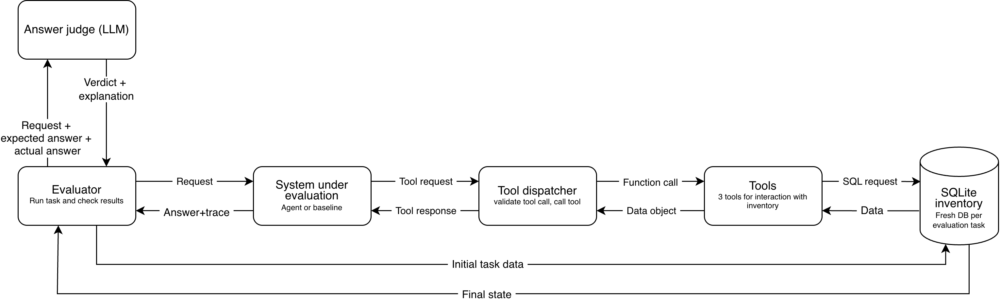

# Inventory agent

**Authors:** Pranas Žeromskas, Gabrielė Skirmantaitė  
**Course:** Large Language Models  

The Agent route was chosen. The goal of the project is to manage a shop’s inventory through natural-language requests.

The project compares an LLM-based agent with a scripted baseline. Both systems use the same tools, database structure, initial inventory, and evaluation tasks. The main question is whether LLM-based action selection handles requests more successfully than simple keyword and number-extraction rules.

## System and tools
Inventory is stored in a SQLite database. Products have an ID, name, quantity, and unit price.

Three tools provide access to the inventory:
- `list_products` returns product information, optionally filtered by a case-insensitive name substring.
- `add_product` creates a product with a required name and price. Quantity defaults to zero.
- `modify_product` changes selected fields of a product identified by its ID. Unspecified fields remain unchanged.
The tool dispatcher validates arguments against JSON schemas before execution and returns a consistent success or error response.

The agent uses a local Ollama model to choose tool calls. Tool results are added to its working conversation before the next model response. Execution ends when the model produces an answer, encounters a technical failure, or reaches the limit of six model responses.

The prompt instructs the agent to retrieve product IDs before modifying products and to ask for clarification when information is missing or ambiguous.

## Scripted baseline

The baseline uses fixed rules without an LLM:
- Request keywords select listing, creation, or modification.
- Existing products are identified through name matching.
- New product names must be enclosed in quotes.
- Simple numeric extraction identifies prices and quantities.
- Tools are called after successful information extraction.
- Responses are generated from predefined messages.

These rules have a limited language understanding. More complex sentence structures can be parsed incorrectly.

## Agent

The agent uses a local Ollama model to interpret requests and select inventory tools. It receives the conversation history, system instructions, and tool definitions. After each tool call, the application validates and executes the call, adds the result to the conversation, and asks the model for its next action. The process ends with a plain-text answer, a technical failure, or a limit of six model responses.

## Evaluation
The evaluation contains 20 tasks covering inventory questions, product creation, modifications, ambiguous requests, duplicates, and invalid values.

Each task runs against a fresh database initialized with the same inventory. The evaluator checks:
- Whether the final database matches the expected state.
- Whether the execution stop reason matches the expectation.
- How many tool calls were invalid.
- Whether the answer matches the expected meaning.
Answer correctness is assessed by a separate qwen3.5:2b judge with thinking disabled. The judge receives only the request, expected answer, and actual answer. Database and tool-call checks are performed independently in Python.

Each run saves the task definitions, configuration, timing, and a trace for every task. The systems being evaluated do not receive the expected outcomes.

## Results and analysis
The scripted baseline and `qwen2.5:7b` agent were evaluated on the same 20 tasks, using identical initial inventories and expected outcomes. Answers were graded by `qwen3.5:2b` with thinking disabled.

| Metric | Scripted baseline | Agent |
|---|---:|---:|
| Automatically passed tasks | 7/20 | 15/20 |
| Correct final database state | 14/20 | 17/20 |
| Answers accepted by judge | 9/20 | 16/20 |
| Invalid tool calls / total | 0/27 | 2/25 |
| System execution time | 0.02 s | 200.89 s |

The agent achieved higher task completion on this set, but required substantially more execution time. The baseline produced no schema-invalid calls, yet still made incorrect changes. This shows that valid arguments alone do not establish task correctness.

Inspection of the traces revealed several important behaviors:
- Limited request recognition: the baseline rejected questions such as “How many drills are in stock?” because they did not contain supported action keywords.
- Incorrect number extraction: when asked to set Drill quantity to 12, the baseline also changed its price to €12. For a request specifying quantity 7 and price €85, it used 7 for both fields.
- Successful multi-step execution: the agent retrieved the Phillips screwdriver quantity and increased it from 15 to 20. It also recovered from a missing `product_id` error by listing products and retrying the modification successfully.
- Incorrect product selection: the agent renamed Drill instead of Flathead screwdriver after guessing ID 1. Its final answer claimed the requested rename succeeded, but the database check detected the error.
- Invented missing information: when asked to add Pliers without a price, the agent created it with an invented price of €19.95 instead of asking for clarification.
- Search limitations: the agent searched for “drills,” which did not match the stored singular name “Drill,” and failed to answer the quantity question.

## Sources and AI use
The implementation uses Ollama, Python’s SQLite support, and JSON Schema validation. The design follows the course materials on agents and tool use.

AI assistance was used to discuss the architecture, refactor and improve the code, and prepare evaluation tasks. All answers were valided, proposed changes were reviewed to ensure understanding and correctness.